<p align="center">
  
</p>

# Mr. PR

Mr. PR is a fast interface for reviewing GitLab merge requests. It runs
entirely in the browser and keeps GitLab as the source of truth.

> **Status:** Alpha.

## How it works


## Private by design


## Quick start

Open the site, paste a link to any merge request, and sign in with GitLab.
Your browser talks to GitLab directly — there is nothing to install and no
server in between. See [docs/site-setup.md](./docs/site-setup.md) to host it
yourself.

## Current scope

Mr. PR reads text diffs and lets you create, reply to, resolve, and
unresolve GitLab discussions. If GitLab rejects a multiline position,
Mr. PR tries the last selected line and then posts a clearly labeled
general discussion. It does not submit approvals, batch reviews, or render
oversized/binary files.

## Development

```console
npm ci --prefix web
npm test --prefix web -- --run
npm run lint --prefix web
npm run build:site --prefix web
```

Run it locally with `npm run dev:site --prefix web`.

---

Contributions are welcome through
[issues](https://github.com/jmoraispk/mrpr/issues) and pull requests.
Mr. PR is released under the [MIT License](./LICENSE).
